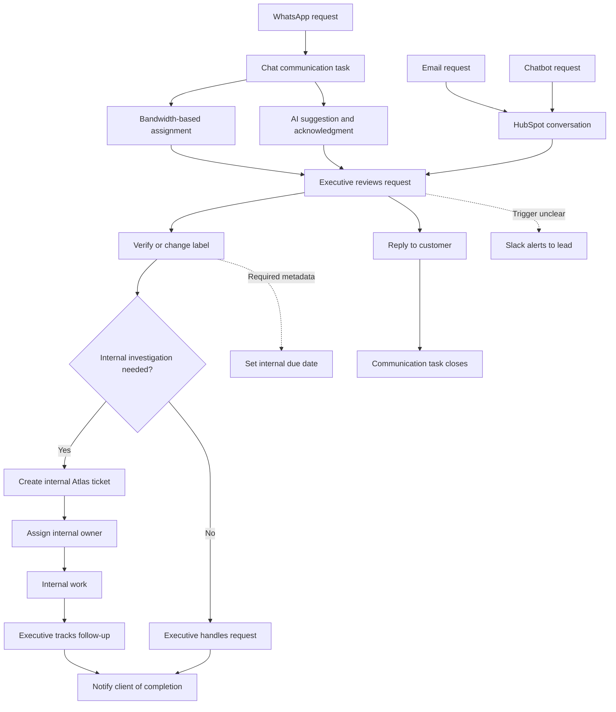

# Current support workflow: P01 interview

Status: research reconstruction, first draft, 5 November 2026. Not a proposed product design or a universal support process.

Evidence: [P01 interview synthesis](../research/interviews/p01-support-practitioner.md). Solid arrows show reported relationships; dashed arrows show links or timing that need clarification. Placement does not establish exact ordering of AI acknowledgment, task creation and labeling.

## Read this before using the map

- WhatsApp/chat AI behavior is reported. The same AI behavior is not established for email.
- Communication-task closure is shown as a separate branch because the participant reports closure on reply while internal follow-up may remain. There is no verified shared completion state across the tools.
- The personal tracker records work, status, point of contact and ticket reference. The participant uses it for follow-ups; it is not a system-driven notification service.
- Label-dependent deadlines and manual assignment are reported for internal work. Exact configuration and timing need clarification.
- Slack alerts are reported at 30 and 90 minutes, but their trigger is ambiguous. The map intentionally does not label these as confirmed resolution breaches.
- The participant sometimes acts directly, but the interview does not fully specify the no-investigation branch or all closure rules.

## Diagram plan for the assignment

| View | Question it should answer | Evidence/status |
|---|---|---|
| Current workflow | Where does work move today, and where does the executive compensate manually? | First draft above; one adjacent B2B interview |
| Proposed support journey | How does the missing-delivery case move from intake through investigation, action and closure? | Not yet designed; must identify assumptions and AI/human ownership |
| Decision flow | What evidence and policy determine investigation, replacement, refund or escalation? | Not yet designed; merchant-specific policies needed |
| Case states | What is open, awaiting customer, awaiting courier, awaiting approval, action pending or resolved? | Candidate concepts only; states and transitions not approved |

These are operational workflow diagrams. Backend architecture, services or databases should only be added if they help explain a product behavior and are explicitly marked as assumptions.
