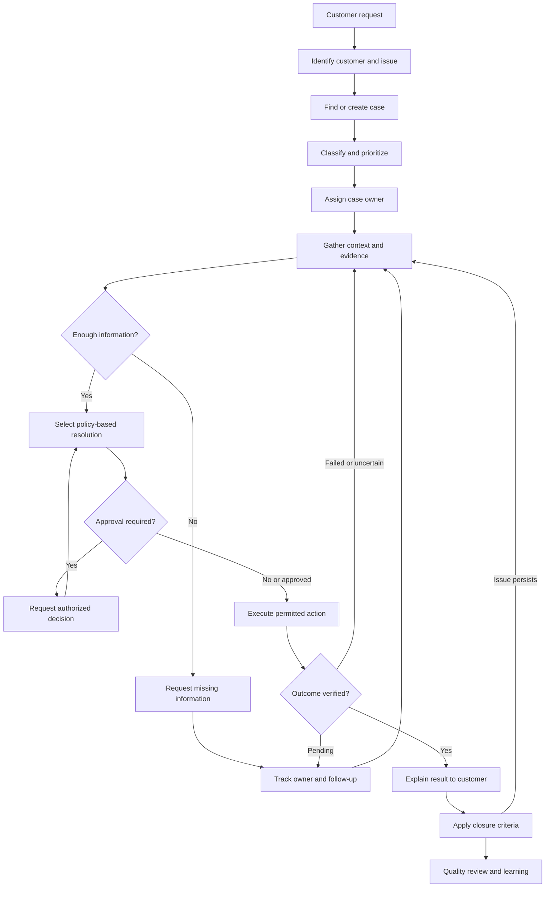
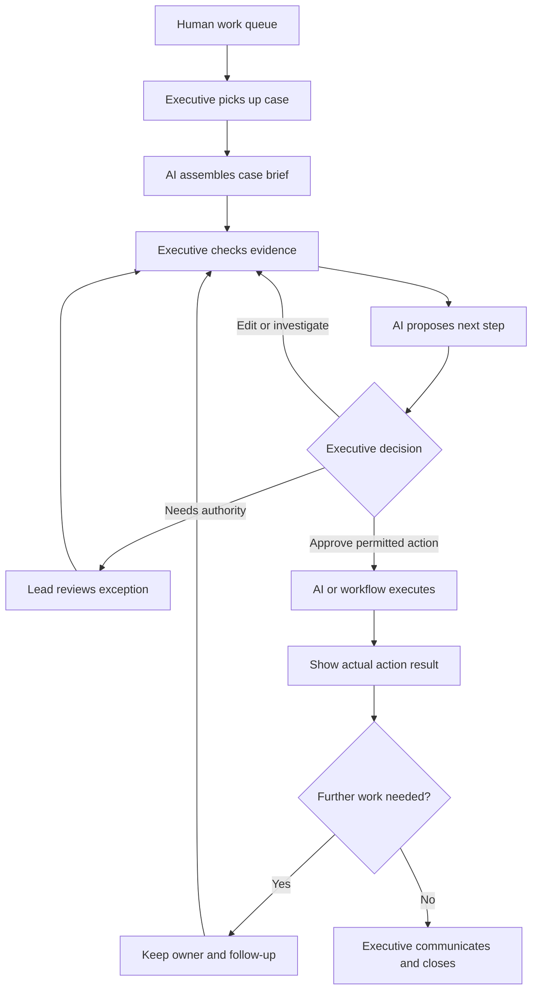
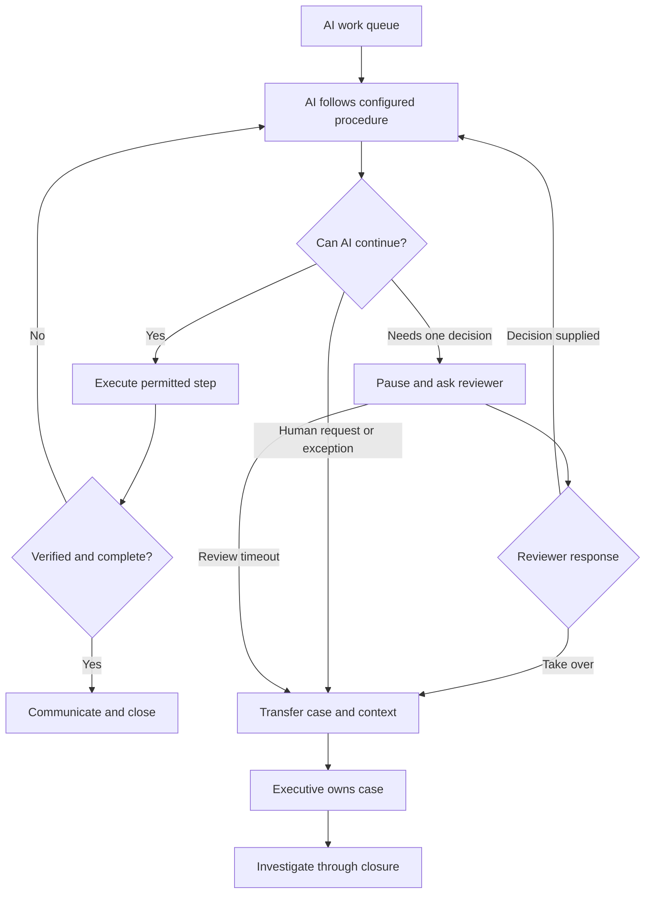

# General support lifecycle and AI ownership models

Status: conceptual working maps, 5 November 2026. These synthesize public product documentation and research; they are not a universal company SOP or approved product design. No implementation architecture is implied.

## Shared lifecycle

Different issue types can use this lifecycle: order tracking, delivery disputes, payment issues, cancellations, returns, refunds and product questions. Their evidence, policy and actions differ. A case may need several investigation/action loops.

Interpretation: the approval branch revises or confirms the plan. Re-checking authority should use the recorded decision, not repeatedly request the same approval. For informational requests the action can simply be providing a verified answer. A rejected request can also be a completed case when its reason and escalation options have been communicated under the applicable policy; closure does not always mean a refund.

## Model A: executive owns the case, AI assists

The executive retains responsibility. AI helps retrieve, classify, draft and execute configured actions; it is not assumed to have every integration or permission. Approval of an action does not itself prove the action succeeded.

## Model B: AI owns the case, humans handle exceptions

These are ownership models, not mutually exclusive categories of product. Human approval can occur in both. In Model B, supplying an answer lets AI continue; taking over changes ownership. In either model, waits and unsuccessful actions must remain visible. AI that replies without customer confirmation does not automatically establish that the underlying issue was resolved.

## Information needed across issue types

| Object | What the workspace should distinguish |
|---|---|
| Conversation | Messages, channel and what the customer already explained |
| Case | Customer problem, priority, owner, current status and closure criteria |
| Dependent work | Courier/internal task, responsible party, expected update and follow-up |
| Proposed action | Intended change, policy basis and required authorization |
| Action result | Successful, failed, pending or unknown; supporting reference |

This is a conceptual separation for discussion, not a database schema. It responds to the [interview's fragmented records](../research/interviews/p01-support-practitioner.md).

## Sources and limits

- [Zendesk Copilot](https://support.zendesk.com/hc/en-us/articles/7908817636378-About-agent-copilot): human assistance and agent-approved actions.
- [Intercom procedure approvals](https://www.intercom.com/help/en/articles/14468561-human-in-the-loop-approvals-for-fin-procedures): pause for a decision, resume or transfer to a human.
- [Gorgias AI ticket lifecycle](https://docs.gorgias.com/en-US/understand-ai-agent-tags-and-ticket-views-5414491): processing, handover, waiting, action failures and review.
- [Gorgias guidance playbook](https://www.gorgias.com/playbooks/chapters/automate-5): issue-specific instructions and escalation.

These documents establish supported product patterns, not adoption rates, guaranteed performance or the policies of the hypothetical merchant. Closure safeguards and the shared lifecycle above are our working synthesis.
