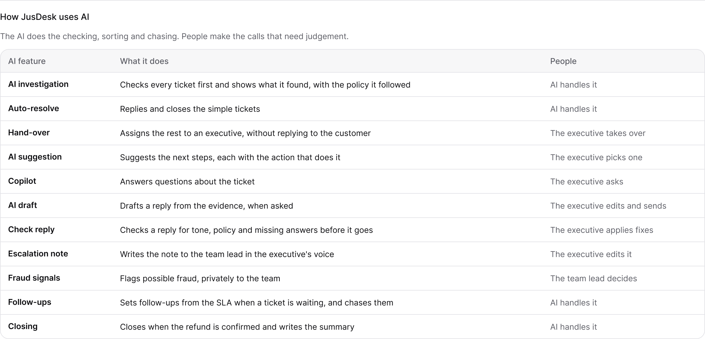

# How JusDesk uses AI

The AI does the checking, sorting and chasing. People make the calls that need judgement.

Where each feature sits in a ticket's life is in the [JusDesk workflow](jusdesk-workflow.md).

| AI feature | What it does | People |
|---|---|---|
| AI investigation | Checks every ticket first and shows what it found, with the policy it followed | AI handles it |
| Auto-resolve | Replies and closes the simple tickets | AI handles it |
| Hand-over | Assigns the rest to an executive, without replying to the customer | The executive takes over |
| AI suggestion | Suggests the next steps, each with the action that does it | The executive picks one |
| Copilot | Answers questions about the ticket | The executive asks |
| AI draft | Drafts a reply from the evidence, when asked | The executive edits and sends |
| Check reply | Checks a reply for tone, policy and missing answers before it goes | The executive applies fixes |
| Escalation note | Writes the note to the team lead in the executive's voice | The executive edits it |
| Fraud signals | Flags possible fraud, privately to the team | The team lead decides |
| Follow-ups | Sets follow-ups from the SLA when a ticket is waiting, and chases them | AI handles it |
| Closing | Closes when the refund is confirmed and writes the summary | AI handles it |

## What the AI never does on its own

- Send money: reships and refunds up to ₹5,000 need the executive; anything above that needs the team lead.
- Deny a claim or accuse a customer: fraud signals stay with the team.
- Reply when it can't stand behind the answer: it hands over in silence instead.
