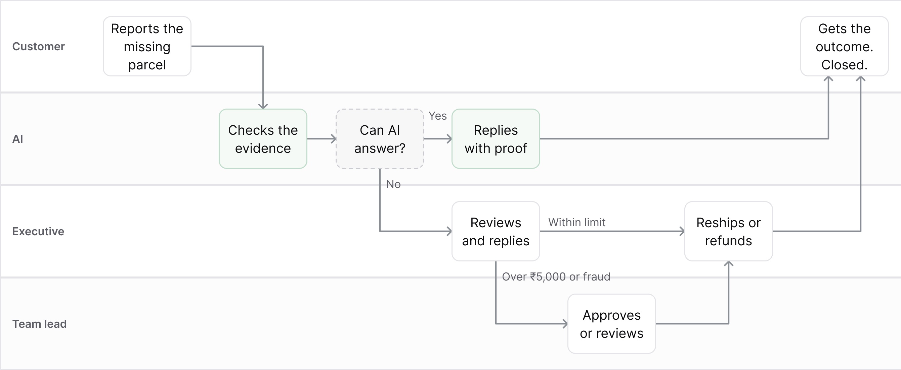

# How a ticket moves in JusDesk

One "marked delivered, not received" ticket, across four lanes: Customer, AI, Executive, Team lead. For the full stage-by-stage feature list, see the [JusDesk workflow](jusdesk-workflow.md). To compare with existing desks, see the [Zendesk](../research/workflow%20research/zendesk-swimlane.md) and [Plain](../research/workflow%20research/plain-swimlane.md) swimlanes.

## Steps

| # | Lane | Step | Next |
|---|---|---|---|
| 1 | Customer | Reports the missing parcel | The AI checks the evidence |
| 2 | AI | Checks the evidence | Decides whether it can answer |
| 3 | AI | Can the AI answer? (decision) | Yes: it replies with proof. No: it hands over to an executive. |
| 4 | AI | Replies with proof | The customer gets the outcome, and the ticket closes |
| 5 | Executive | Reviews and replies | Within the ₹5,000 limit: reships or refunds. Over ₹5,000 or suspected fraud: sends it to the team lead. |
| 6 | Team lead | Approves or reviews | Goes back to the executive, who reships or refunds |
| 7 | Executive | Reships or refunds | The customer gets the outcome, and the ticket closes |
| 8 | Customer | Gets the outcome. Closed. | |

## The rules behind it

- The AI acts alone only when the evidence is clear and no money moves.
- The executive decides reships and refunds up to ₹5,000.
- The team lead approves anything over ₹5,000 and reviews suspected fraud.
- A ticket closes only when the customer knows the outcome.
