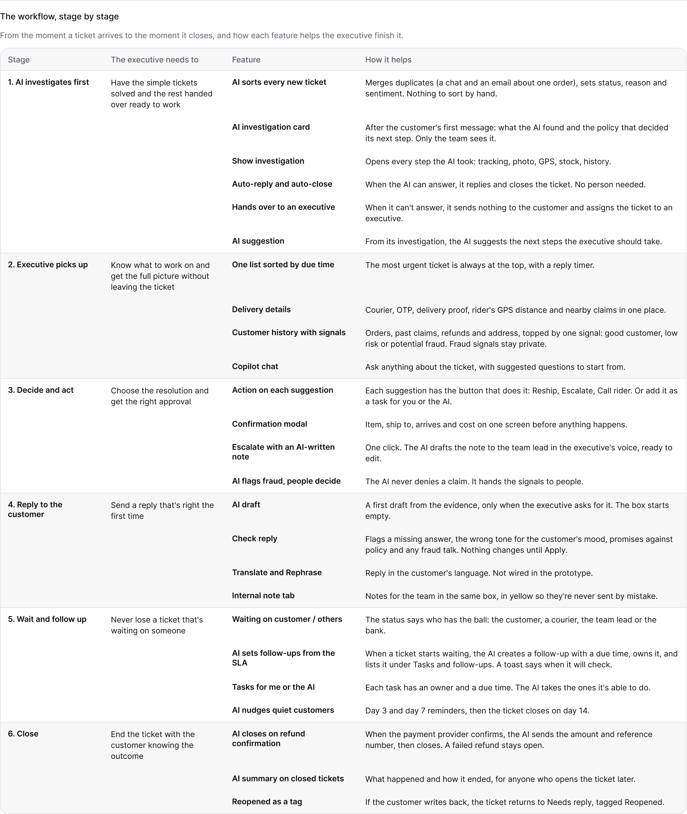

# JusDesk workflow

The AI investigates every ticket first. It closes the simple ones on its own and hands the rest to an executive with its evidence and suggested next steps. The executive decides; the AI keeps following up.

This file follows a ticket from the moment it arrives to the moment it closes, and shows how each feature helps the executive finish it. How each AI feature splits the work with people is in [How JusDesk uses AI](how-jusdesk-uses-ai.md).

| Stage | The executive needs to | Feature | How it helps |
|---|---|---|---|
| 1. AI investigates first | Have the simple tickets solved and the rest handed over ready to work | AI sorts every new ticket | Merges duplicates (a chat and an email about one order), sets status, reason and sentiment. Nothing to sort by hand. |
| | | AI investigation card | After the customer's first message: what the AI found and the policy that decided its next step. Only the team sees it. |
| | | Show investigation | Opens every step the AI took: tracking, photo, GPS, stock, history. |
| | | Auto-reply and auto-close | When the AI can answer, it replies and closes the ticket. No person needed. |
| | | Hands over to an executive | When it can't answer, it sends nothing to the customer and assigns the ticket to an executive. |
| | | AI suggestion | From its investigation, the AI suggests the next steps the executive should take. |
| 2. Executive picks up | Know what to work on and get the full picture without leaving the ticket | One list sorted by due time | The most urgent ticket is always at the top, with a reply timer. |
| | | Delivery details | Courier, OTP, delivery proof, rider's GPS distance and nearby claims in one place. |
| | | Customer history with signals | Orders, past claims, refunds and address, topped by one signal: good customer, low risk or potential fraud. Fraud signals stay private. |
| | | Copilot chat | Ask anything about the ticket, with suggested questions to start from. |
| 3. Decide and act | Choose the resolution and get the right approval | Action on each suggestion | Each suggestion has the button that does it: Reship, Escalate, Call rider. Or add it as a task for you or the AI. |
| | | Confirmation modal | Item, ship to, arrives and cost on one screen before anything happens. |
| | | Escalate with an AI-written note | One click. The AI drafts the note to the team lead in the executive's voice, ready to edit. |
| | | AI flags fraud, people decide | The AI never denies a claim. It hands the signals to people. |
| 4. Reply to the customer | Send a reply that's right the first time | AI draft | A first draft from the evidence, only when the executive asks for it. The box starts empty. |
| | | Check reply | Flags a missing answer, the wrong tone for the customer's mood, promises against policy and any fraud talk. Nothing changes until Apply. |
| | | Translate and Rephrase | Reply in the customer's language. Not wired in the prototype. |
| | | Internal note tab | Notes for the team in the same box, in yellow so they're never sent by mistake. |
| 5. Wait and follow up | Never lose a ticket that's waiting on someone | Waiting on customer / others | The status says who has the ball: the customer, a courier, the team lead or the bank. |
| | | AI sets follow-ups from the SLA | When a ticket starts waiting, the AI creates a follow-up with a due time, owns it, and lists it under Tasks and follow-ups. A toast says when it will check. |
| | | Tasks for me or the AI | Each task has an owner and a due time. The AI takes the ones it's able to do. |
| | | AI nudges quiet customers | Day 3 and day 7 reminders, then the ticket closes on day 14. |
| 6. Close | End the ticket with the customer knowing the outcome | AI closes on refund confirmation | When the payment provider confirms, the AI sends the amount and reference number, then closes. A failed refund stays open. |
| | | AI summary on closed tickets | What happened and how it ended, for anyone who opens the ticket later. |
| | | Reopened as a tag | If the customer writes back, the ticket returns to Needs reply, tagged Reopened. |
